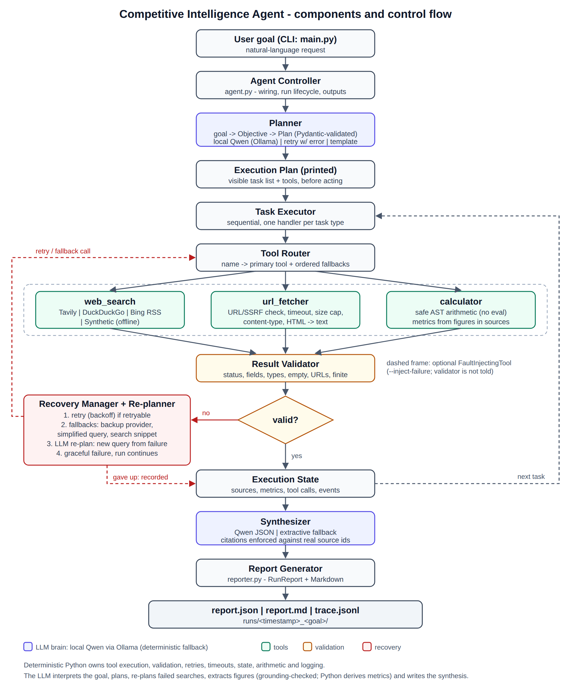

# Competitive Intelligence Agent

A small, production-style **agentic AI system** built for the take-home assignment for the Agentic AI Engineer Intern role. You give it a high-level goal in plain language, for example:

> *"Analyze the competitive landscape of NVIDIA in the AI accelerator market."*

The agent then works through a fixed pipeline:

1. **Plans.** It turns the goal into a structured objective and a task plan, and prints that plan *before* acting.
2. **Uses tools.** It calls three tools one step at a time: web search, a URL fetcher and a safe calculator.
3. **Validates.** It checks every tool result.
4. **Recovers.** When something breaks, it retries, then tries a fallback, and if that fails too, it continues without that result.
5. **Reports.** It writes a cited report in two forms: **JSON (machine-readable) + Markdown (human-readable)**, plus a JSONL execution trace.

```
GOAL -> PLANNING -> TOOL SELECTION -> TOOL EXECUTION -> VALIDATION -> FAILURE RECOVERY -> FINAL REPORT
```

**The brain is a local LLM.** It runs on **Ollama with a Qwen model**: free, private and with no API key. The model interprets the goal, writes the plan, **re-plans when a step fails**, chooses which figures to compute and writes the analysis. Hosted APIs (Anthropic / any OpenAI-compatible endpoint) also work.

## Quick start (Windows, local Qwen)

1. Make sure the Ollama app is running and `ollama list` shows a Qwen model.
2. Double-click **`run_live.bat`**. It will:
   - create the venv and install the requirements,
   - create `.env` (`OLLAMA_MODEL=auto` finds your Qwen model),
   - check the LLM,
   - run the tests,
   - generate the live transcripts in `examples/live_run_0*.md`.

---

## 1. Problem statement

Competitive research is a multi-step task. You find the competitors, read recent news, pull out the numbers, compare them, and write up the findings with sources. Each step depends on data from outside the system, and that data can be missing, malformed, slow or wrong.

The assignment provides **no dataset**. So the agent has to fetch its data live at inference time. A clearly labelled synthetic corpus is used only for offline testing. The agent must also cope with its tools misbehaving.

## 2. Why this is agentic (and not a chatbot)

| Agentic property | Where it happens |
|---|---|
| Takes a high-level goal and breaks it down on its own | `planner.py` turns goal → `Objective` (targets, analysis type, market) → `Plan` of typed tasks with dependencies |
| Visible plan before acting | `render_plan()` prints the task list, tools and execution mode before any tool runs |
| Re-plans when a step fails | `replanner.py`: if a search still fails after retry and fallbacks, the LLM is shown the failed queries and errors and proposes a different approach. The proposal is validated, and a repeated query is rejected |
| Picks tools and runs them | `executor.py` sends each task to `web_search`, `url_fetcher`, `calculator` or `synthesize` through a `ToolRouter` |
| Uses what it observed to decide the next action | Fetch targets come from search results. Calculator expressions come from figures found in the fetched pages |
| Detects when a result is invalid | `validator.py` checks status, schema, types, emptiness, URL safety and finite numbers. It never trusts a result blindly |
| Corrects itself | `recovery.py`: retry with backoff → ordered fallbacks → give up gracefully and carry on |
| Structured final output | `RunReport` (Pydantic) → `report.json` + `report.md` |

## 3. Architecture



The full description, an ASCII version and a Mermaid version are in [`docs/architecture.md`](docs/architecture.md). The one-page design write-up is in [`docs/design.md`](docs/design.md).

**Division of labour:**

- **The LLM (local Qwen via Ollama by default) handles:** interpreting the goal, planning, re-planning after failures, *proposing* metric expressions, and synthesis.
- **Deterministic Python handles:** tool execution, validation, retries and timeouts, state, arithmetic, citation enforcement and logging.

Every step that uses the LLM has a deterministic fallback. If Ollama isn't running, a startup health check notices and the agent still completes the run.

```
competitive-intelligence-agent/
├── main.py                  CLI (goal, --offline, --inject-failure, --check-llm, ...)
├── run_live.bat             one-click Windows setup + LLM check + tests + live transcripts
├── app/
│   ├── agent.py             controller + dependency wiring (build_agent)
│   ├── planner.py           goal interpretation, LLM planner, template planner, plan display
│   ├── replanner.py         LLM re-planning when a task fails all tool-level recovery
│   ├── executor.py          sequential task execution, one handler per task type
│   ├── validator.py         validation of every tool result + citation enforcement
│   ├── recovery.py          retry / fallback / graceful-failure policy
│   ├── metrics.py           figures -> calculator expressions (LLM, grounding-checked, or regex)
│   ├── synthesizer.py       LLM synthesis (citations enforced) or extractive fallback
│   ├── reporter.py          RunReport + Markdown rendering
│   ├── llm.py               Ollama (JSON mode, Qwen auto-detect) / Anthropic / OpenAI clients
│   ├── tracing.py           [TAG] console logs + JSONL trace, secret redaction
│   ├── config.py            settings from environment variables
│   ├── text_utils.py        sentence splitting, heuristic company detection
│   ├── models/              Pydantic models: plan, tool_result, report, state
│   └── tools/               web_search (DuckDuckGo / Bing RSS / Tavily / Wikipedia / synthetic), url_fetcher,
│                            calculator, router, fault_injection, synthetic corpus server
├── data/synthetic_corpus.json   FICTIONAL offline test corpus (clearly labelled)
├── tests/                   128 pytest tests (no network, no model needed)
├── examples/                3 sample run transcripts (verbatim program output)
├── scripts/make_examples.py regenerates the transcripts (offline or --live)
├── scripts/evaluate.py      labelled evaluation: fault-injection matrix + guard precision/recall
├── scripts/monitor.py       monitoring report + HTML dashboard from saved runs
├── data/eval/               hand-labelled cases for the grounding and metric guards
├── evaluation/              evaluation report + labelled traces (generated)
├── monitoring/              monitoring report + dashboard (generated from live runs)
└── docs/                    architecture.md, architecture.png/.svg, design.md
```

## 4. Features

- **Planning.** The LLM plans are validated against a strict Pydantic schema:
  - ids must be sequential,
  - dependencies can only point to *earlier* tasks,
  - a fetch task must depend on a search task,
  - the plan must end with exactly one `synthesize` task.

  If an LLM plan is invalid, the agent sends it back once with the validation error. If it is still invalid, it falls back to the deterministic template planner.
- **Three tools behind one `Tool` interface.** Tools never raise exceptions. They always return a `ToolResult(success, data, error{type, message, retryable}, duration_ms)`.
  - `web_search(query)`: search providers can be swapped. The default is **keyless, with no account or login**: **DuckDuckGo** web results, falling back to **Bing web RSS** and then **Bing news RSS**. **Tavily** is used first if you add a key. **Wikipedia** is optional; it needs `AGENT_CONTACT` because Wikimedia returns 403 to anonymous clients. A **synthetic** provider is used offline.
  - `fetch_url(url)`: validates the URL, blocks private/internal addresses (**SSRF**, server-side request forgery) including after redirects, applies a timeout and a 2 MB size cap, checks the content-type, extracts readable text from the HTML, and truncates it to a maximum length.
  - `calculate(expression)`: an **AST whitelist** (no `eval`). It also blocks huge exponents and division by zero, and requires a finite result.
- **Validation of every call:** missing or wrong-typed fields, empty results, malformed items, invalid URLs, pages that are too short, and calculator results that are not numbers or not finite.
- **Recovery:**
  - Retry with backoff, but only for *retryable* errors. Timeouts, 5xx and 429 are retried. 404 and invalid input are not.
  - Then ordered fallbacks: the secondary search provider, then a simplified query, and for pages, the search snippet in place of the full page.
  - If all of that fails, the task fails *gracefully* and the run continues.
  - Every failure and recovery is counted and listed in the report.
- **Deliberate fault injection:** `--inject-failure TOOL:MODE[:N]`, with modes `malformed`, `empty`, `timeout`, `http_error`, `bad_json` and `crash`. The fault wrapper is invisible to the validator, so detection is real.
- **Anti-hallucination guards:**
  - Report findings may only cite source ids that tools actually retrieved. Unknown ids are removed, and a "fact" left with no valid citation is relabelled as *inference*.
  - Every number in an LLM-proposed metric must appear literally in a cited source.
  - The Markdown report visibly separates **sourced facts `[S#]`** from ***Analysis*** (inference).
- **Observability:** `[AGENT] [PLAN] [TASK n] [TOOL] [VALIDATION] [ERROR] [RECOVERY] [RESULT] [FAULT]` console lines, plus a per-run `trace.jsonl` with durations, attempts and error types. Secrets are redacted.

## 5. Tech stack

Python 3.11+, **Pydantic v2**, **httpx**, **BeautifulSoup4**, python-dotenv, standard `logging`, **pytest**.

The LLM is served locally by **Ollama** (Qwen by default). There are no agent frameworks, vector DBs, Docker or LLM SDKs. The LLM clients are about 40 lines of `httpx` each, so any provider can be swapped in.

**Why Ollama's native API rather than its OpenAI-compatible endpoint?** It supports `format: "json"`, which forces the model to output valid JSON. That makes a big reliability difference for 7B–14B models. The client also:
- raises the context window (`num_ctx`) so the source excerpts fit,
- strips Qwen3 `<think>…</think>` blocks before parsing.

## 6. Installation

```bash
git clone <repo-url> competitive-intelligence-agent
cd competitive-intelligence-agent
python -m venv .venv
```

Activate the environment:

```bash
# Windows (PowerShell / cmd)
.venv\Scripts\activate
# macOS / Linux
source .venv/bin/activate
```

Install and configure:

```bash
pip install -r requirements.txt
copy .env.example .env        # Windows   (macOS/Linux: cp .env.example .env)
```

## 7. Environment variables

All of these are optional. With no LLM, the agent uses the deterministic planner and synthesizer. Search works with no keys at all (DuckDuckGo → Bing).

| Variable | Purpose |
|---|---|
| `OLLAMA_MODEL` | **Local brain.** `auto` (the default) picks an installed Qwen model. Or pin a tag from `ollama list`, e.g. `qwen2.5:7b` or `qwen3:8b` |
| `OLLAMA_BASE_URL` | Default `http://localhost:11434` |
| `OLLAMA_NUM_CTX` | Context window (default 8192; use 16384 if you have the memory) |
| `LLM_TIMEOUT_S` | LLM request timeout (default 300 s for Ollama, 120 s for hosted) |
| `ANTHROPIC_API_KEY` / `OPENAI_API_KEY` | Hosted alternative to Ollama. Used when `OLLAMA_MODEL` is empty |
| `LLM_PROVIDER` | Force a provider: `ollama` \| `anthropic` \| `openai` \| `none` |
| `LLM_MODEL` | Defaults: `claude-sonnet-5` / `gpt-4o-mini` |
| `LLM_BASE_URL` | Any OpenAI-compatible endpoint (Groq, Together, Ollama, ...) |
| `TAVILY_API_KEY` | Optional search API, used first when set |
| `SEARCH_PROVIDER` | `auto` (DuckDuckGo → Bing) \| `bing` \| `tavily` \| `wikipedia` |
| `AGENT_CONTACT` | Optional email/URL added to the User-Agent; required only to enable Wikipedia |
| `HTTP_TIMEOUT_S`, `MAX_RETRIES`, `RETRY_BACKOFF_S`, `MAX_SOURCES`, `MAX_PAGE_CHARS` | Robustness knobs |

Keys are read only from the environment. They are never logged (the tracer redacts them) and never written to outputs.

## 8. Running the agent

```bash
# Check the brain first: is Ollama up, is the model installed, does it return valid JSON?
python main.py --check-llm

# Live: real web data (keyless search + your local Qwen via Ollama)
python main.py "Analyze the competitive landscape of NVIDIA in the AI accelerator market"

# Offline demo: no internet; uses the FICTIONAL synthetic corpus (still uses local Qwen if Ollama runs)
python main.py --offline "Analyze the competitive landscape of Voltaic Semiconductors in the AI accelerator market"

# Interactive prompt
python main.py
```

Useful flags:

| Flag | What it does |
|---|---|
| `--show-report` | Prints the Markdown report at the end |
| `--transcript FILE` | Saves the console output to a file |
| `--no-llm` | Forces the deterministic path |
| `--check-llm` | Tests the configured LLM and exits |
| `--output-dir DIR` | Where run folders are written (default `runs/`) |
| `-v` | Adds timestamps to log lines |

Each run writes `runs/<timestamp>_<goal>/report.json`, `report.md` and `trace.jsonl`. The exit code is `0` if the run completed, `1` if it failed, and `2` for bad input.

## 9. Example usage

```bash
python main.py "Compare NVIDIA and AMD in AI accelerators" --show-report
python main.py "Research recent developments of AMD"
python main.py "Produce a short competitive intelligence brief on Snowflake in cloud data warehousing"
```

The sample transcripts are in [`examples/`](examples/). All of them are verbatim program output.

**Live** runs (real web data + local qwen3:8b via Ollama, Windows PC):

- [`live_run_01_normal.md`](examples/live_run_01_normal.md): NVIDIA competitive landscape
- [`live_run_02_comparison.md`](examples/live_run_02_comparison.md): NVIDIA vs AMD
- [`live_run_03_failure_recovery.md`](examples/live_run_03_failure_recovery.md): AMD developments with **injected** failures (malformed search response + fetch timeouts), plus real 403s, all recovered

**Offline** runs (fictional synthetic corpus, no network, deterministic fallbacks):

- [`run_01_normal.md`](examples/run_01_normal.md), [`run_02_comparison.md`](examples/run_02_comparison.md), [`run_03_failure_recovery.md`](examples/run_03_failure_recovery.md)

> **Honesty note:** the `run_0*` transcripts were produced in a sandbox with **no internet access and no LLM**, so they use `--offline` mode with the deterministic fallbacks. Offline mode swaps in only the data source (fictional companies such as "Voltaic Semiconductors"). Everything else is the real code path: planning, HTTP fetching and HTML parsing (through an in-process mock transport), validation, retries, fallbacks, the calculator and reporting. The **live** transcripts (real web data + local Qwen) come from `run_live.bat`, or equivalently:
>
> ```bash
> python scripts/make_examples.py --live      # writes examples/live_run_0*.md (web + local Qwen)
> python scripts/make_examples.py --live --only 2   # regenerate a single run
> ```

## 10. Failure-recovery demonstration

```bash
python main.py --offline --inject-failure web_search:malformed --inject-failure url_fetcher:timeout:2 \
  "Research recent developments of Voltaic Semiconductors"
```

What happens (excerpt from `examples/run_03_failure_recovery.md`):

```
[FAULT] Deliberate failure armed: web_search -> 'malformed' for the next 1 call(s) (validator is not told)
[TOOL] web_search[synthetic] query="Voltaic Semiconductors recent developments" (attempt 1)
[ERROR] invalid tool response: missing "results" [malformed_response]
[RECOVERY] Validation failed. Retry attempt 1/1 in 0.5s...
[TOOL] web_search[synthetic] query="Voltaic Semiconductors recent developments" (attempt 2)
[VALIDATION] passed in 1 ms
[RECOVERY] Recovered via retry (attempt 2/2)
...
[ERROR] request timed out (ReadTimeout) [timeout]
[RECOVERY] Tool call failed. Retry attempt 1/1 in 0.5s...
[ERROR] request timed out (ReadTimeout) [timeout]
[RECOVERY] Giving up after 2 attempt(s): request timed out (ReadTimeout)
[RECOVERY] Degraded gracefully: using search snippet for S1 instead of full page
...
[RESULT] status=completed | tasks 6/6 | tool calls=14 | failures=3 | recoveries=2 | sources=5
```

Other scenarios to try:

- `--inject-failure web_search:malformed:2`: the retry also fails, so the agent switches to the **secondary search provider**.
- `--inject-failure web_search:empty`: the identical retry is skipped and the agent goes straight to the fallbacks.
- `--inject-failure web_search:crash`: the tool raises an exception. It is caught and converted to a structured error.
- An offline goal about a company that is not in the corpus: every search fails, and the run ends with an honest `failed` report and exit code 1.

## 11. Testing

```bash
pytest
```

There are 128 tests. They need no network and no model: HTTP goes through `httpx.MockTransport` and the LLM is scripted. Coverage:

- planner output and plan-schema validation, including the LLM retry and template fallback
- web-search normalisation and malformed/HTTP/timeout errors
- URL validation, including SSRF and redirect checks
- the calculator's safety cases
- fetch timeouts and HTTP errors
- validator cases
- **a real simulated malformed tool response → retry → recovery**, plus fallback to a secondary provider, snippet degradation and graceful total failure
- citation enforcement, metric grounding, final report JSON/Markdown, and a CLI end-to-end run
- the Ollama client: JSON mode, errors, model check, Qwen auto-detect, `<think>` stripping
- a full run with the LLM as the brain
- LLM re-planning after a search that fails everything, including rejecting a repeated query
- falling back when Ollama is down
- keyless search parsing (DuckDuckGo HTML, Bing RSS): ads are skipped, redirects unwrapped, and a bot-check page becomes an empty result that triggers the fallback
- the relevance filter
- sanity checks on LLM metrics (a bare copied number, a "%" that never multiplies by 100, a fake CAGR)
- figures in "facts" must appear in the cited source

Several of these tests come from mistakes a real run with qwen3:8b made (see "Lessons from live runs").

A quick mutation check was also done: disabling the `"results"` check in the validator makes 4 recovery tests fail.

## Evaluation and monitoring

**Evaluation** (`python scripts/evaluate.py`, about 2 s, offline and deterministic) writes `evaluation/evaluation_report.md` plus labelled traces:

| Suite | What is labelled | Result |
|---|---|---|
| Fault-injection matrix: 111 runs (3 goals x (clean + 3 tools x 6 failure modes x transient/persistent)) | 1563 tool calls, ground truth = "was this call really faulty" (set by the harness, never shown to the agent) | Failure detection precision **100.0%**, recall **100.0%**; faulted step recovered in **90/108** runs; **0** crashes. The 18 unrecovered runs are persistent calculator outages (no fallback exists): the run still ends `completed_with_warnings` with a brief |
| Numeric-grounding guard | 27 hand-labelled claims (hallucinated vs grounded), incl. 7 blind-spot probes | Core: P 100.0% / R 100.0%. With probes: P 76.9% / R 71.4% (misses a real number attached to the wrong company/period; flags unit conversions) |
| Metric sanity check | 22 labelled metric expressions, incl. the mistake patterns qwen3:8b made in live runs | Core: P 100.0% / R 100.0%. With probes: R 75.0% (semantic errors like swapped operands pass syntax checks) |

**Monitoring** (`python scripts/monitor.py`) aggregates every saved run in `runs/` into `monitoring/monitoring_report.md` and a self-contained `monitoring/dashboard.html`: run success rate, per-tool success and latency (p50/p95), LLM latency by purpose, errors by type, recovery events, search-provider usage, and threshold alerts. On the 20 live runs made while building: 17/20 completed (the 3 failures were the Wikipedia-403 runs before the search fix; the last 10 runs are 10/10), 211 tool calls, 62 failures, 26 recoveries, and 98% of runtime spent waiting on the local LLM.

## Lessons from live runs (evaluating my own agent)

I ran the agent end to end on a Windows PC with **qwen3:8b on Ollama** and real web data. Each problem below was found in a live run, fixed, and turned into a regression test.

| # | What went wrong in the live run | Fix | Test |
|---|---|---|---|
| 1 | Every Wikipedia call returned **HTTP 403**: Wikimedia now blocks clients without contact info | Default search switched to keyless DuckDuckGo → Bing RSS; Wikipedia is opt-in via `AGENT_CONTACT`. The failures were caught as non-retryable, fallbacks and the Qwen re-plan ran, and the run ended in an honest `failed` report | `test_keyless_search.py` |
| 2 | Qwen3's "thinking" mode made one planning call run for over 5 minutes | Send `think: false` in JSON mode; the health-check call went from 42 s to about 2–9 s | `test_ollama_uses_native_chat...` |
| 3 | Bing returned generic pages (OpenAI, ChatGPT, Gemini) for a market query, and the agent fetched them | A relevance filter drops search hits that mention none of the objective's terms before fetching | `test_relevance_filter...` |
| 4 | Qwen wrote nonsense arithmetic: a copied number (`"86"`), a figure minus itself (`40 - 40`), `432 - 432/(432/50)`, a "CAGR" of `518.12/174.69 - 1`, and ratios reported in GB. Checks for each pattern kept turning up new variants | **Redesign:** Qwen now only *extracts labelled figures* (entity, metric, value, unit, period, source), and each value must appear in its cited source. Python *derives* growth, CAGR, percentage-point change and share-of-combined, and the calculator evaluates them. The sanity checks (`is_well_formed`) remain as a safety net, and the regex extractor is the fallback. Shares are derived only for additive metrics such as revenue; specs like memory capacity get an `A vs B` ratio instead (a live run had produced "share of combined memory capacity") | `test_llm_extracts_figures...`, `test_derive_metrics...`, `test_metric_sanity_checks...` |
| 5 | The report cited S3 for "CAGR 24.29%", a number the agent had computed itself | Any "fact" whose figures are missing from its cited source is relabelled as *Analysis* | `test_fact_with_figure_missing...` |
| 6 | Synthesis hit the 300 s timeout on a long prompt | Prompts now carry the most relevant lines of each page (1,200 chars) instead of the first 2,500, with lower token caps. Synthesis now takes about 3 minutes | `test_relevant_excerpt...` |
| 7 | The test suite read the developer's `.env` and called the real model | Tests are isolated from `.env` and API keys | `conftest.py` |

## 12. Limitations

- **Output quality depends on the local model.** A 7B Qwen is fine for planning, but its analysis is shallower than a hosted frontier model's. Its occasional bad JSON is caught and triggers the retry and fallback paths. 14B+ is noticeably better.
- **Real-web variety.** The live path was run 20 times on a Windows PC (see `monitoring/`), but real-world page variety (paywalls, JavaScript-rendered pages, cookie walls) will lower full-page fetch rates. The snippet fallback softens this.
- **Keyless search scrapes public HTML/RSS**, so it is more fragile than an API. DuckDuckGo may show a bot-check page. That page is detected as an empty result and the agent falls back to Bing. Some sites return 403 or render with JavaScript only; for those the agent uses the search snippet instead of the full page.
- **Without an LLM:**
  - The competitor list is a heuristic: capitalised names found in competitive contexts. It can include non-competitors or miss some.
  - The report is extractive: it quotes sentences from the sources rather than analysing them.
- **Metrics come only from figures stated in sources.** A metric inherits its source's definitions and time periods, and the agent does not reconcile differing fiscal years or definitions.
- Re-planning covers failed *search* tasks only. Fetch and calculation failures use deterministic degradation. Execution is sequential.
- There are no persistent caches or rate-limit budgeting.

## 13. Future improvements

- **Broader re-planning:** extend it to every task type. Add a critic step that scores report coverage against the objective and requests follow-up searches.
- **An evaluation harness:** a set of goals with checks such as citation precision, source diversity, recovery rate and cost per run.
- **Better retrieval:** date filters for recency, domain-quality scoring, and a headless browser for JavaScript-rendered pages.
- **Performance:** parallel fetching with a concurrency limit, response caching, and per-provider rate limiting.
- **More tools:** structured financial data (e.g. SEC EDGAR filings) as a numeric tool, so metrics stop depending on figures in news text.
