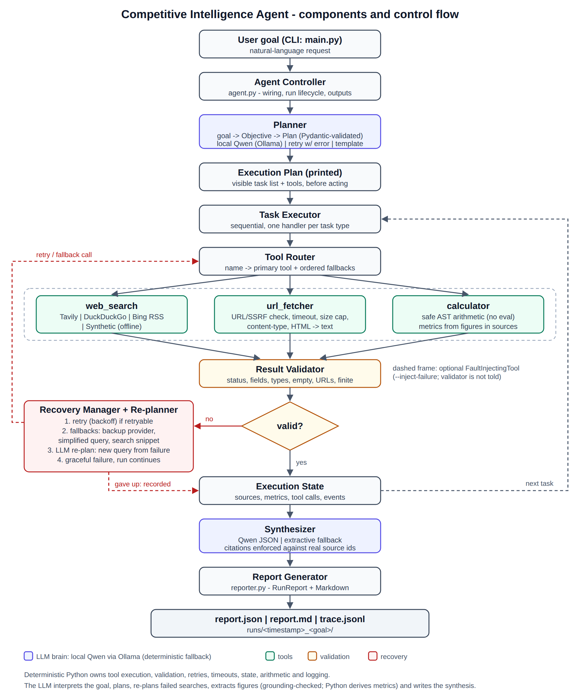
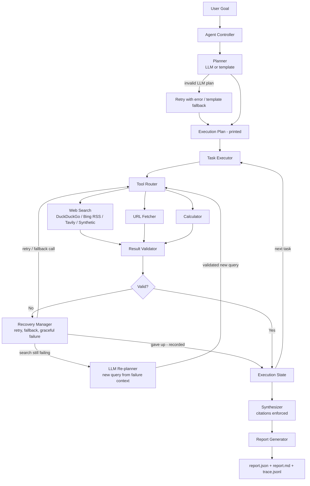

# Architecture



(The source is `architecture.svg`, and a Mermaid version is further down.)

## ASCII overview

```
                         User goal (CLI: main.py)
                                   |
                                   v
                      +--------------------------+
                      |     Agent Controller     |  agent.py: wiring, lifecycle, saving outputs
                      +--------------------------+
                                   |
                                   v
                      +--------------------------+     LLM plan -> Pydantic validation
                      |         Planner          |     -> 1 corrective retry
                      |  goal -> Objective->Plan |     -> template planner fallback
                      +--------------------------+
                                   |
                                   v
                      +--------------------------+
                      |  Execution Plan (printed)|  shown BEFORE any tool runs
                      +--------------------------+
                                   |
                                   v
                      +--------------------------+ <-------------------------+
                      |      Task Executor       |  sequential               |
                      +--------------------------+                           |
                                   |                                          |
                                   v                                          |
                      +--------------------------+ <------------+            |
                      |       Tool Router        |              |            |
                      +--------------------------+              |            |
                     /             |              \             |            |
                    v              v               v            |            |
          +--------------+ +---------------+ +--------------+   |            |
          |  web_search  | |  url_fetcher  | |  calculator  |   |            |
          | DDG|Bing RSS | | | validate URL, | | safe AST     |   |            |
          | Synthetic    | | timeout, cap, | | arithmetic   |   |            |
          +--------------+ | HTML->text    | +--------------+   |            |
                    \      +---------------+      /             |            |
                     \             |             /              | retry /    |
                      v            v            v               | fallback   |
                      +--------------------------+              |            |
                      |     Result Validator     |              |            |
                      +--------------------------+              |            |
                                   |                            |            |
                              valid? --- no ---> +----------------------+    |
                                   |             |   Recovery Manager   |    |
                                  yes            | retry -> fallbacks   |    |
                                   |             | -> LLM re-plan       |    |
                                   |             | -> graceful failure  |    |
                                   v             +----------------------+    |
                      +--------------------------+          | gave up         |
                      |     Execution State      | <--------+ (recorded)      |
                      | sources, metrics, calls, |                            |
                      | events                   | ---- next task ------------+
                      +--------------------------+
                                   | (after the last tool task)
                                   v
                      +--------------------------+
                      |       Synthesizer        |  LLM JSON (citations enforced)
                      |                          |  or extractive fallback
                      +--------------------------+
                                   |
                                   v
                      +--------------------------+
                      |     Report Generator     |  RunReport (Pydantic) + Markdown
                      +--------------------------+
                                   |
                                   v
                  report.json  |  report.md  |  trace.jsonl
```

## Mermaid



## Components

| Component | File | What it does |
|---|---|---|
| CLI | `main.py` | Parses the goal and flags, sets up the transcript tee, returns the exit code |
| Controller | `app/agent.py` | `build_agent()` injects every dependency: tools, providers, LLM, fault injection. `run()` runs plan → display → execute → report → save |
| LLM | `app/llm.py` | `OllamaClient` (local Qwen: native `/api/chat`, JSON mode, `num_ctx`, model auto-detect, health check), plus Anthropic / OpenAI-compatible clients. `<think>` blocks are stripped before JSON parsing |
| Re-planner | `app/replanner.py` | When a search fails after retry and fallbacks, the LLM gets the failed queries and errors and proposes a new query. The proposal is validated, and a repeated query is rejected |
| Planner | `app/planner.py` | `interpret_goal()` (rule-based `Objective`), `TemplatePlanner`, `LLMPlanner` (validate → corrective retry → fallback), `render_plan()` |
| Models | `app/models/` | `Objective`, `Task`, `Plan` (with structural validators), `ToolResult`, `ValidationReport`, `Source`, `Metric`, `Finding`, `RunReport`, `ExecutionState` |
| Executor | `app/executor.py` | One handler per task type. The fetch handler picks URLs round-robin across searches and dedupes them. The calculator handler gets metric proposals and evaluates them through the tool |
| Router | `app/tools/router.py` | Maps each tool name to a primary tool and ordered fallbacks. `wrap()` is used for fault injection |
| Tools | `app/tools/*.py` | A shared `Tool.run()` wrapper handles timing and catches exceptions. Providers can be swapped behind `SearchProvider` |
| Validator | `app/validator.py` | Checks each tool type's result, returns only the clean search hits, and enforces citations on the synthesized report |
| Recovery | `app/recovery.py` | `RecoveryPolicy(max_retries, backoff)` and `Fallback(label, tool, kwargs)`. Records every attempt (`ToolCallRecord`) and every event |
| Metrics | `app/metrics.py` | The LLM extracts labelled figures, and each value must appear in its cited source. `derive_metrics` computes growth, CAGR, percentage-point change and share deterministically. `RegexMetricExtractor` is the fallback |
| Synthesizer | `app/synthesizer.py` | `LLMSynthesizer` (JSON, validated, citations enforced, retry, fallback) and `ExtractiveSynthesizer` (verbatim cited sentences) |
| Reporter | `app/reporter.py` | Computes status and counters and renders the required Markdown sections |
| Tracing | `app/tracing.py` | Tagged console lines + JSONL events, with secret redaction |

## Data and control flow for one tool call

1. The executor builds the arguments. For a fetch, the URLs come from earlier *validated* search hits. For the calculator, the expressions come from figures in the fetched sources.
2. `RecoveryManager.execute()` calls `tool.run()`. The tool never raises: a timeout, HTTP error, bad JSON or crash all come back as `ToolResult(success=False, error=...)`.
3. `ResultValidator.validate()` checks the result. A result can say `success=True` and still fail validation, for example when `"results"` is missing.
4. If the result is invalid and the error is retryable, the manager backs off and retries.
5. If it is still invalid, the manager tries each fallback in order (backup provider, simplified query).
6. If everything fails, it records `gave_up`. For search tasks, the executor then asks the **LLM re-planner** for a different query and runs it through the same retry and validation path. Otherwise it degrades: it uses the search snippet instead of the page, skips the task, or marks it failed.
7. Every attempt goes into `state.tool_calls`. Every failure and recovery goes into `state.events`. Both appear in `report.json` and in the Markdown "Agent Execution Summary".
